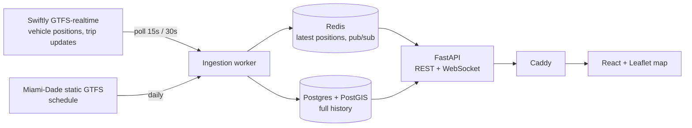

# Ghost Bus Miami

[](https://github.com/AndrewPuig77/ghost-bus-miami/actions/workflows/ci.yml)

> Transit apps show where your bus is. This shows whether you can count on it.

A live map of every Miami-Dade bus that also keeps a record of what actually happened. Every
GPS ping is stored, and that history is used to measure reliability: **ghost buses** (trips
that were scheduled but never showed up), lateness, bunching, and arrival estimates with honest
ranges instead of a single minute.

**Status:** in active development. Live ingestion and the live map work; the reliability
analysis is being built now. A public site is coming.

## Features

| | Feature |
|---|---|
| ✅ | **Live map.** Every bus, updated over a WebSocket as new positions arrive |
| ✅ | **Freshness.** Each bus is colored by how old its GPS fix is, so a stale position looks stale |
| ✅ | **Route view.** Pick a route to see only its buses, drawn on the route's actual path |
| ✅ | **Data delay warning.** The map says so when live data stops arriving |
| 🚧 | **Ghost bus detection.** Scheduled trips that were never canceled and never appeared |
| 🚧 | **Lateness and bunching**, measured at every stop from the GPS history |
| ⏳ | **Route report cards** and **arrival ranges** ("8–14 min", not "10 min") |
| ⏳ | **Fallback mode** when the live feed is down, and **alerts** for your routes |

## How it works



- **Ingestion worker** (Python, asyncio): polls vehicle positions every 15s and trip updates
  every 30s. Every request shares one rolling budget that stays under the provider's rate
  limit; failures back off exponentially and a `429` pauses everything. Each poll is logged.
- **History** (Postgres + PostGIS): pings go into daily partitions; each static schedule is
  stored as its own version (identified by its SHA-256), so old history still joins to the
  schedule that was in effect at the time.
- **Live path** (Redis): the worker writes each bus's latest position and publishes what moved.
  The API holds one subscription and fans it out to every browser, dropping any client that
  falls behind instead of letting it slow the others.
- **Map** (React, TypeScript, Leaflet): a snapshot on connect, then streamed updates.
  Ages are measured against the server's clock, so a wrong device clock can't make data look
  fresher than it is.

### Engineering notes

- **Rate limits as a hard constraint:** a rolling-window budget (150 of the 180 allowed
  requests per 15 minutes) is enforced in one place for every request.
- **Bulk loading:** the ~1M-row schedule loads through `COPY` into staging tables in a single
  transaction; a new version becomes active only once it has loaded completely.
- **Data quality:** pings with impossible timestamps or `(0, 0)` positions are dropped, a
  repeated GPS timestamp is stored once, and canceled trips keep when they were first seen
  canceled.
- **Infrastructure as code:** Terraform creates the cloud network and server; GitHub Actions
  runs lint, tests against a real PostGIS database, image builds and Terraform validation on
  every pull request, then deploys `main` after CI passes.
- **ARM-ready:** the Postgres + PostGIS image is built from `db/Dockerfile` because the common
  PostGIS image is x86-only.

## Tech stack

- **Backend:** Python 3.13, FastAPI, asyncio, psycopg 3, Alembic
- **Data:** PostgreSQL 17 + PostGIS, Redis
- **Frontend:** React, TypeScript, Vite, Leaflet
- **Infrastructure:** Docker Compose, Caddy, Terraform (Oracle Cloud), GitHub Actions

## Run it locally

You need Docker and your own [Swiftly](https://www.goswift.ly/) API key for Miami-Dade
real-time data. No key is included in this repository.

```sh
cp .env.example .env    # set SWIFTLY_API_KEY and a Postgres password
docker compose up --build
docker compose run --rm api python -m app.gtfs.loader   # load the schedule (safe to re-run)
```

- Map: http://localhost:8080
- API: http://localhost:8000/health

Database migrations run automatically on startup. The worker reloads the schedule daily.

### Tests

The tests run against real Postgres and Redis (a scratch database and Redis db 15):

```sh
docker compose run --rm -v ./backend:/src -w /src \
  -e UV_PROJECT_ENVIRONMENT=/tmp/venv -e UV_LINK_MODE=copy \
  -e TEST_ADMIN_DSN=postgresql://ghostbus:change-me@db:5432/ghostbus \
  -e TEST_REDIS_URL=redis://redis:6379/15 \
  api uv run pytest
```

### Developing without containers

Backend, with [uv](https://docs.astral.sh/uv/):

```sh
cd backend
uv sync
uv run pytest
uv run ruff check .
uv run uvicorn app.api.main:app --reload
```

Frontend, with Node 22+ (Vite forwards `/api` and `/ws` to the API on port 8000):

```sh
cd frontend
npm install
npm run dev    # http://localhost:5173
```

## API

| Endpoint | Returns |
|---|---|
| `GET /api/vehicles` | Every bus heard from in the last 30 minutes, with `server_time` |
| `WS /ws/vehicles` | A snapshot on connect, then each poll's moved buses as they arrive |
| `GET /api/status` | Last attempt, success and error for each live feed |
| `GET /api/routes` | Routes from the active schedule, in number order |
| `GET /api/routes/{id}/shapes` | GeoJSON of every path the route's trips follow |

## Repository layout

```
backend/
  app/
    api/         FastAPI routes and WebSocket
    worker/      live feed polling, parsing and storage
    gtfs/        static schedule loader
    detection/   ghost, lateness and bunching jobs (in progress)
    config.py    settings from environment variables
  migrations/    database migrations (Alembic)
  tests/
frontend/        React app, and the Caddy config that serves it
db/              Postgres + PostGIS image (x86 and ARM)
infra/           Terraform for the cloud server, and deployment notes
.github/         CI and deploy workflows
docker-compose.yml
```

Deployment is described in [infra/README.md](infra/README.md).

## Data and attribution

- Real-time vehicle positions and trip updates: [Swiftly](https://www.goswift.ly/) GTFS-realtime
  API.
- Schedule: [Miami-Dade Transit](https://www.miamidade.gov/global/transportation/home.page)
  public GTFS feed.
- Map data © [OpenStreetMap](https://www.openstreetmap.org/copyright) contributors.

This is an independent project. It is not affiliated with or endorsed by Miami-Dade County,
Miami-Dade Transit, or Swiftly.
